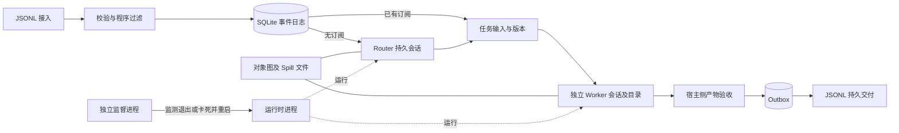

# super-agent-runtime

A local, durable event-driven Router/Worker runtime. **Engineering prototype, not a hosted autonomous agent service.**

把 Super-agent 的工程机制落实为可运行、可验收的代码：统一事件、跨来源任务关联、话题订阅直通、持久模型会话、上下文按需读取、独立监督、独立产物验收及持久交付。

本仓库不绑定微信。已实现 JSONL 输入/输出适配器；示例中的 `chat`、`github`、`mail` 是合成来源标签，**不代表接入了这些真实服务**。需要真实服务时，由连接器把事件转换为下述格式；接入微信的 UI 操作不包含在本仓库。

## 从可重复实验开始

Python 3.11+，运行时和离线测试均只依赖标准库：

```sh
python -m unittest discover -v
python scripts/demo.py
python scripts/verify_supervisor.py
```

`demo.py` 验证：聊天发起任务 → 另一来源关联同一任务 → 后续事件绕过 Router → 重新打开数据库仍保留任务和会话引用 → 验收产物 → 交付恢复去重。它使用明确标记的确定性测试 backend，不调用模型。

`verify_supervisor.py` 启动独立监督进程，终止该监督进程启动的子运行时，确认它用不同 PID 重新启动，然后停止测试进程。只操作该测试自行创建的进程和 `.demo/` 状态。

真实模型验收另行运行，会使用本机已登录 Codex CLI 与额度：

```sh
python scripts/smoke_codex.py
```

它验证真实 Router/Worker、在重开数据库后的精确会话恢复、直通补充与宿主侧 SHA-256 验收。没有登录/网络或沙箱不支持时会失败，不能拿离线测试替代它。

## 架构



每个 runtime 实例代表一个可信工作区，共享上下文。它不是多租户系统。一个 Thread 是一个话题、Issue 或邮件串，不能把整个活跃群聊直接当成同一任务的话题。

## 事件约定

每行一个完整 JSON 对象，行末需要换行：

```json
{"source":"example-chat","source_id":"m-001","thread":"topic-001","actor":"example-user","kind":"message","text":"Create a local report","occurred_at":"2026-11-01T00:00:00Z","reply_to":null}
```

- `(source, source_id)` 是源端稳定消息身份。重复内容、不同身份是不同事件；同身份不同内容拒绝覆盖。没有稳定身份的 UI 来源需要在适配器中显式解决断档与歧义。
- `thread` 是源内话题身份，`reply_to` 是同来源的被回复消息 ID。所有正文原样保存。
- `allowed_sources` 和 `ignored_actors` 是宿主策略，先过滤再调用模型。被过滤事件仍留在审计日志。
- 订阅是多对多关系；Worker 可把不属于自己的事件 handoff 回 Router，同时取消对应话题订阅。
- 订阅只影响输入路由，不自动扩大输出受众。任务结果默认交回最初发起话题。

## 运行服务

在仓库根目录运行，先准备自己的 JSONL spool 文件：

```sh
python -m agent_runtime --state .state run --backend codex --inbox events.jsonl --output replies.jsonl --policy config.local.json
```

用独立监督进程管理同一个运行时：

```sh
python -m agent_runtime --state .state supervise --backend codex --inbox events.jsonl --output replies.jsonl --policy config.local.json
python -m agent_runtime --state .state status
python -m agent_runtime --state .state stop
```

输入可由另一个进程持续追加。Worker 运行时，采集、直通和新的 Router 批次仍可继续。默认两个 Worker，单个任务内串行，同一任务的补充进入下一版本；运行中的模型回合不会被中途插入消息。

`STOP` 是持久的所有者停止标记。确认停止后，删除本实例的 `STOP` 文件才能再次启动。服务前台运行；实际部署用 OS 服务管理器维持 supervisor 自身的生命周期。本仓库不会安装系统服务或更改登录/权限设置。

配置示例：

```json
{
  "allowed_sources": ["example-chat", "example-issues"],
  "ignored_actors": ["example-bot"],
  "acceptance_sha256": {}
}
```

默认没有可信验收预期，Worker 报告完成后为 `needs_review`。对可精确验收的任务，所有者可以在 `acceptance_sha256` 中指定 `{ "产物相对路径": "预先确定的 SHA-256" }`。运行时独立读取实际文件、检查路径范围并计算哈希；预期不能由模型或外部事件生成。当前哈希验收适合固定产物；复杂软件的可信测试验收属于后续里程碑。

## 连续性与恢复

- Router 和各任务分别持有明确的 provider session ID，使用真实 `codex exec resume <id>`，从不使用模糊的 `--last`，也不使用 `--ephemeral`。进程按回合启动，会话是逻辑常驻的。
- 会话 ID 与任务状态在 SQLite 保存；模型完整历史由 Codex CLI 保存在本机。模型计算与本地状态已解开进程生命周期，但**尚未实现跨设备可迁移的完整模型会话**。
- 原文事件、订阅、任务版本、决策和 Outbox 事务化。Worker 认领携带运行 token，旧结果不能覆盖新运行。
- 运行中收到补充时，先完成当前版本并标记结果已被新输入修订，再运行下一版本。
- 过期或状态不明的 Worker 标为 `interrupted`，不自动重复有副作用的工作。外部 supervisor 重启的是运行时，不是盲目重跑任务。
- JSONL 交付先写入并 `fsync`，再确认 Outbox。恢复时根据持久实例 ID + outbox 编号去重。外部平台将来仍需独立幂等键/回执，不能直接承诺跨平台 exactly-once。

## 上下文按需读取

`context.py` 将完整 Event、Thread、Task 对象物化成相互引用的 JSON 文件，模型提示只内联有预算的摘要与索引。文件中保留下一跳引用，可按 `Event → Thread → Task → 其他 Thread` 展开，正文不因摘要而丢失。

```sh
python -m agent_runtime --state .state recall event EVENT_ID
python -m agent_runtime --state .state recall thread THREAD_ID
python -m agent_runtime --state .state recall task TASK_ID
```

当前是在磁盘物化相关连通图，输入 spool 也会重读并靠稳定 ID 去重；大图、长时间高流量场景需要增量游标、分页和按需召回端点。这些上限写在实现及 [技术决策](docs/decisions.md) 中。

## 执行边界

真实 backend 采用只读 Router、可写任务目录 Worker，关闭工具网络和 Web 搜索，不继承用户 MCP/hooks 配置；保留本机模型连接和现有 Windows 沙箱设置。它不使用完全访问或跳过审批/沙箱的参数，并继续遵守本机执行规则。

CLI 沙箱不是完整宿主机读取隔离；接受公开不可信输入前需要专用账户/容器和凭据隔离。当前没有云端 daemon、真实 IM/GitHub 发送、生产部署、付款或跨组织授权。supervisor 只判断进程退出、心跳停滞和任务租约；尚不判断模型是否在语义上空转。

完整的决策、验收边界和下一步见 [docs/decisions.md](docs/decisions.md) 与 [VALIDATION.md](VALIDATION.md)。Codex 会话恢复选项依据[官方非交互文档](https://learn.chatgpt.com/docs/non-interactive-mode)及本机 CLI 帮助。
